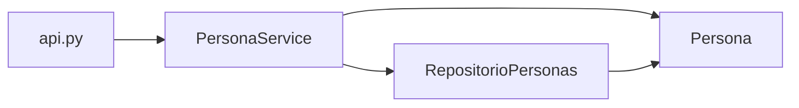

# TP 1 - Parte 2: CRUD de Persona

Continuación del TP 1: se agregan el PUT y el DELETE.

API REST en Flask para una Persona con DNI y nombre, siguiendo la receta de CRUD vista en clase (modelo → repositorio → servicio → API).

## Reglas de negocio

* El DNI no se puede repetir (validado en el servicio).
* El nombre comienza con mayúscula, continúa con minúsculas y no tiene más de 30 caracteres (validado en el modelo).

## Estructura del proyecto

```
/
├── api.py
├── models/
│   └── persona.py
├── repositories/
│   └── persona_repository.py
└── services/
    └── persona_service.py
```



## Cómo correrlo

```
pip install flask
python api.py
```

La API queda en `http://127.0.0.1:5000`.

## Endpoints (probar con Thunder Client)

| Método | URL | Descripción |
|---|---|---|
| GET | `/persona` | Lista todas las personas |
| GET | `/persona/1` | Devuelve la persona con DNI 1 (404 si no existe) |
| POST | `/persona` | Agrega una persona (409 si el DNI ya existe, 400 si los datos son inválidos) |
| PUT | `/persona/1` | Modifica el nombre de la persona con DNI 1 (404 si no existe) |
| DELETE | `/persona/1` | Borra la persona con DNI 1 (204 si la borró, 404 si no existe) |

Body del POST:

```json
{
  "dni": 40123456,
  "nombre": "Guido"
}
```

Body del PUT:

```json
{
  "nombre": "Juancito"
}
```
